<h1 align="center"><samp>Turning Ideas Into Apps</samp> </h1>


  


  


  


  

<a href="https://github.com/joewrdd/MaikaDog"></a>
<a href="https://jwardportfolio.vercel.app/#projects"></a>
<a href="https://youtu.be/W7Co15OOIC0"></a>
<a href="https://youtube.com/shorts/qZYBXaDlDfE"></a>
<a href="https://jwardportfolio.vercel.app/#projects"></a>
<a href="https://youtube.com/shorts/kTMkjgB8FL8"></a>

  


  

<a href="https://x.com/joewrdd">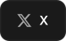</a>
<a href="https://www.instagram.com/joewrdd">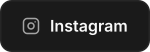</a>
<a href="mailto:wrddio@hotmail.com">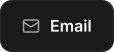</a>

  


